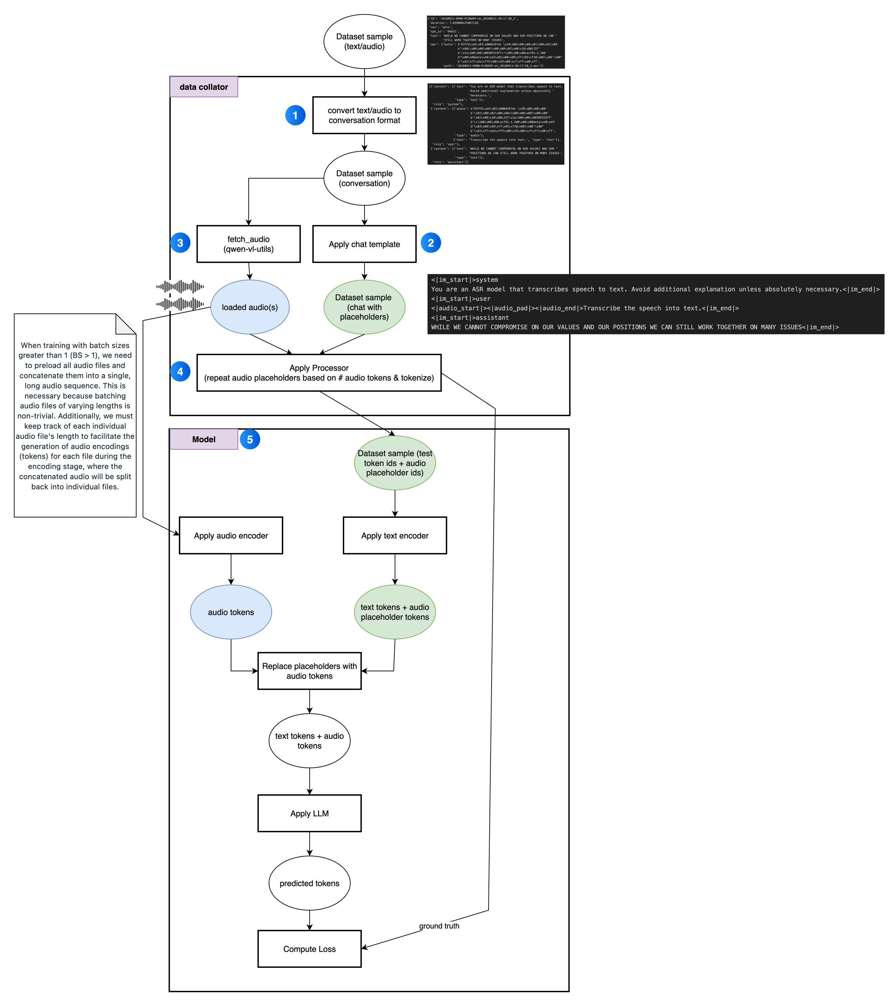

# Proiect: Qwen2-VL-7B + Whisper encoder pentru ASR — note de referință

Sursa cursului: <https://huggingface.co/learn/audio-course> (cod sursă: `github.com/huggingface/audio-transformers-course`, `chapters/en/`).
Template proiect: [`templates/fine_tuning_vlm_for_speech_understanding_trl.ipynb`](../templates/fine_tuning_vlm_for_speech_understanding_trl.ipynb)

---

## 1. Diagrama pipeline-ului



> Randată din [`VLA.drawio`](../VLA.drawio). Pentru zoom fără pierdere de calitate: [`VLA.svg`](VLA.svg).
> Re-randare după editarea diagramei:
> ```bash
> /Applications/draw.io.app/Contents/MacOS/draw.io -x -f png -s 2 -b 20 -o docs/VLA.png VLA.drawio
> /Applications/draw.io.app/Contents/MacOS/draw.io -x -f svg -o docs/VLA.svg VLA.drawio
> ```

### Pașii numerotați → secțiunile din notebook

| # | Bloc în diagramă | Notebook | Unde se scrie codul |
|---|---|---|---|
| 1 | convert text/audio → conversation format | Step #1: Format Dataset (`format_data`) | notebook |
| 2 | Apply chat template | Step #2: Create chat template + tokenii `<\|audio_start\|>`, `<\|audio_pad\|>`, `<\|audio_end\|>` | `processor.chat_template`, push pe HF |
| 3 | fetch_audio (qwen-vl-utils) | Step #3: Load audio | fork `qwen-vl-utils` → `vision_process.py` |
| 4 | Apply Processor (repetă `<\|audio_pad\|>` după nr. de audio tokens + tokenizează) | Step #4: Extend the Processor | fork `transformers` → `models/qwen2_vl/processing_qwen2_vl.py` |
| 5 | Model: audio encoder → audio tokens → înlocuiește placeholder-ele → LLM → loss | Step #5: Create the Model | fork `transformers` → `modeling_qwen2_vl.py` + `configuration_qwen2_vl.py` |

Pașii 1–4 sunt în interiorul **data collator**-ului; pasul 5 e **modelul**.

### Cum arată datele în fiecare etapă (din screenshot-urile din diagramă)

> Dataset-ul `speechbrain/LargeScaleASR` a fost redenumit [`speechbrain/LoquaciousSet`](https://huggingface.co/datasets/speechbrain/LoquaciousSet) (URL-ul vechi redirecționează). Are configurațiile `small` / `medium` / `large` / `clean`, iar `small/` are 72 de shard-uri parquet.

**Eșantion brut din `speechbrain/LargeScaleASR`:**
```python
{'ID': '20180911-0900-PLENARY-en_20180911-20:17:50_2',
 'duration': 7.839,
 'sex': 'male',
 'spk_id': '96651',
 'text': 'WHILE WE CANNOT COMPROMISE ON OUR VALUES AND OUR POSITIONS WE CAN STILL WORK TOGETHER ON MANY ISSUES',
 'wav': {'bytes': b'RIFF...WAVEfmt ...', 'path': '...wav'}}
```
Audio-ul vine ca **bytes WAV nedecodați** (de aceea `fetch_audio` încarcă din byte-object), iar textul e **UPPERCASE fără punctuație**.

**După pasul 1 (format conversație):**
```python
[{'role': 'system',    'content': [{'type': 'text',  'text': 'You are an ASR model that transcribes speech to text. Avoid additional explanation unless absolutely necessary.'}]},
 {'role': 'user',      'content': [{'type': 'audio', 'audio': b'RIFF...'},
                                   {'type': 'text',  'text': 'Transcribe the speech into text.'}]},
 {'role': 'assistant', 'content': [{'type': 'text',  'text': 'WHILE WE CANNOT COMPROMISE ...'}]}]
```

**După pasul 2 (chat template aplicat):**
```text
<|im_start|>system
You are an ASR model that transcribes speech to text. Avoid additional explanation unless absolutely necessary.<|im_end|>
<|im_start|>user
<|audio_start|><|audio_pad|><|audio_end|>Transcribe the speech into text.<|im_end|>
<|im_start|>assistant
WHILE WE CANNOT COMPROMISE ON OUR VALUES AND OUR POSITIONS WE CAN STILL WORK TOGETHER ON MANY ISSUES<|im_end|>
```

**Nota din diagramă (batch size > 1):** toate audio-urile din batch se pre-încarcă și se concatenează într-o singură secvență lungă; se păstrează lungimea fiecăruia ca să poată fi re-împărțite la encodare (același pattern ca `pixel_values` + `image_grid_thw` la Qwen2-VL).

---

## 2. Concepte din curs care contează direct pentru proiect

### Audio digital (Unit 1)
- **Sampling rate** = eșantioane/secundă. Vorbirea are frecvențe < 8 kHz → **16 kHz** e suficient (limita Nyquist = sr/2). Whisper e antrenat la 16 kHz; orice audio trebuie **resamplat la 16 kHz** înainte de feature extractor.
- 5 s la 16 kHz = 80.000 valori. Sampling rate-uri diferite → secvențe diferite → modelul nu generalizează; de aceea toate exemplele trebuie aduse la același sr.
- **Bit depth**: 16-bit = 65.536 nivele. Modelele lucrează pe float în **[-1.0, 1.0]** (librosa returnează deja float).
- **Downsampling** corect necesită filtru anti-aliasing → folosește librării (librosa, torchaudio, 🤗 Datasets), nu „arunca fiecare al doilea sample”.
- **Waveform** (domeniul timp) vs **spectru** (DFT/FFT, domeniul frecvență) vs **spectrogramă** (STFT: multe DFT-uri pe ferestre scurte, stivuite în timp).
- **Mel spectrogram**: frecvențele trecute prin filterbank mel (scară perceptuală). **Log-mel** = în dB. Atenție: există variante (htk vs slaney, power vs amplitude, log vs dB) → calculează-l exact cum îl aștepta modelul.

### Arhitecturi (Unit 3)
- **CTC** (Wav2Vec2, HuBERT): encoder-only + cap liniar pe caractere, un output la ~20 ms; tokenul *blank* elimină duplicatele. Greșeli fonetice de ortografie (`CHRISTMAUS`).
- **Seq2Seq** (Whisper): encoder pe log-mel → decoder autoregresiv cu cross-attention, rol de language model; loss = cross-entropy; metrică = WER.
- **Proiectul nostru** = a treia variantă: păstrăm doar **encoderul Whisper**, iar rolul decoderului îl preia **LLM-ul Qwen2-VL** (prin audio tokens injectați în secvența de text).

### Whisper — detalii de input
- Feature extractor-ul **pad-uiește/trunchiază la 30 s** (de aceea nu are attention mask) și calculează log-mel.
- Cursul dă forma `(80, 3000)` — valabilă pentru tiny…large-v2. **Whisper turbo (`large-v3-turbo`) folosește 128 mel bins → `(128, 3000)`**.
- 3000 cadre mel (10 ms/cadru) → conv cu stride 2 → **1500 vectori de encoder per 30 s ⇒ 50 vectori/secundă (20 ms fiecare)**. Asta stă la baza numărului de `<|audio_pad|>` per audio de la pasul 4.
- Encoder turbo: același ca large-v3 (32 straturi, `d_model = 1280`); decoder-ul a fost redus la 4 straturi, dar noi nu-l folosim. Qwen2-VL-7B are `hidden_size = 3584` ⇒ proiectorul audio mapează 1280 → 3584.
- Atât encoderul HF, cât și cel din pachetul `openai-whisper` presupun intrare de exact 3000 cadre (positional embedding fix de 1500). Dacă vrei token-uri doar pentru partea ne-padată, tai output-ul encoderului după lungimea reală (`ceil(durată_s * 50)`), nu inputul.
- Exemplele **> 30 s** se filtrează (altfel sunt trunchiate și destabilizează antrenarea).

### Evaluare (Unit 5)
- **WER** = (S + I + D) / N, *lower is better*, poate depăși 100 %. **CER** pentru limbi fără cuvinte.
- **Normalizare**: antrenezi pe text ortografic, evaluezi pe text normalizat (`BasicTextNormalizer` → lowercase, fără punctuație). LargeScaleASR e deja uppercase fără punctuație, deci normalizarea în special aliniază casing-ul.
- **RTFx** = durata audio / timp de procesare (viteză).

---

## 3. Snippet-uri din curs → unde le folosim în notebook

### TASK „load the dataset in streaming mode” (Unit 1 · Streaming)
```python
from datasets import load_dataset

gigaspeech = load_dataset("speechcolab/gigaspeech", "xs", streaming=True)
next(iter(gigaspeech["train"]))           # nu merge indexarea ds[i] în streaming
gigaspeech_head = gigaspeech["train"].take(2)
list(gigaspeech_head)
```
Adaptare pentru proiect (netestată; `data_files` ca în celula 60 din notebook):
```python
ds = load_dataset("speechbrain/LargeScaleASR", data_files=["small/train-0000*"], split="train", streaming=True)
sample = next(iter(ds.take(1)))
```

### TASK „grab 1 sample, check content, visualize the wave with librosa” (Unit 1 · Audio data)
```python
import librosa, librosa.display
import matplotlib.pyplot as plt
import numpy as np

# waveform
plt.figure().set_figwidth(12)
librosa.display.waveshow(array, sr=sampling_rate)

# spectru (DFT pe primele 4096 eșantioane)
dft_input = array[:4096]
window = np.hanning(len(dft_input))
dft = np.fft.rfft(dft_input * window)
amplitude_db = librosa.amplitude_to_db(np.abs(dft), ref=np.max)
frequency = librosa.fft_frequencies(sr=sampling_rate, n_fft=len(dft_input))
plt.figure().set_figwidth(12); plt.plot(frequency, amplitude_db); plt.xscale("log")

# spectrogramă (STFT)
D = librosa.stft(array)
S_db = librosa.amplitude_to_db(np.abs(D), ref=np.max)
plt.figure().set_figwidth(12)
librosa.display.specshow(S_db, x_axis="time", y_axis="hz"); plt.colorbar()

# mel spectrogram
S = librosa.feature.melspectrogram(y=array, sr=sampling_rate, n_mels=128, fmax=8000)
S_dB = librosa.power_to_db(S, ref=np.max)
plt.figure().set_figwidth(12)
librosa.display.specshow(S_dB, x_axis="time", y_axis="mel", sr=sampling_rate, fmax=8000); plt.colorbar()
```
În LargeScaleASR audio-ul e în `sample["wav"]["bytes"]`, deci trebuie decodat întâi (ex. `librosa.load(io.BytesIO(b), sr=16000)` sau `soundfile.read(io.BytesIO(b))`).

### TASK „use whisper to process an audio file” (Unit 1 · Preprocessing + Unit 3)
```python
from transformers import WhisperFeatureExtractor

feature_extractor = WhisperFeatureExtractor.from_pretrained("openai/whisper-small")

def prepare_dataset(example):
    audio = example["audio"]
    if audio["sampling_rate"] != 16000:
        audio_array = librosa.resample(audio["array"], orig_sr=audio["sampling_rate"], target_sr=16000)
        audio = {"array": audio_array, "sampling_rate": 16000}
    features = feature_extractor(audio["array"], sampling_rate=audio["sampling_rate"], padding=True)
    return features

# vizualizarea log-mel-ului care intră în Whisper
librosa.display.specshow(
    np.asarray(input_features[0]), x_axis="time", y_axis="mel",
    sr=feature_extractor.sampling_rate, hop_length=feature_extractor.hop_length,
)
```
Pentru turbo: `openai/whisper-large-v3-turbo` (HF) sau pachetul `openai-whisper` (`whisper.load_model("turbo")`, `whisper.pad_or_trim`, `whisper.log_mel_spectrogram(audio, n_mels=model.dims.n_mels)`, apoi doar `model.encoder(mel)`).

### Resampling în dataset (Unit 1 · Preprocessing)
```python
from datasets import Audio
ds = ds.cast_column("audio", Audio(sampling_rate=16_000))   # resampling on-the-fly
```

### Filtrare după durată (Unit 1 + Unit 5)
```python
MAX_DURATION_IN_SECONDS = 30.0
def is_audio_length_in_range(input_length):
    return input_length < MAX_DURATION_IN_SECONDS

ds = ds.filter(is_audio_length_in_range, input_columns=["duration"])   # LargeScaleASR are deja coloana `duration`
```

### TASK „data collator” (Unit 5 · Fine-tuning) — pattern-ul de bază
```python
@dataclass
class DataCollatorSpeechSeq2SeqWithPadding:
    processor: Any

    def __call__(self, features):
        input_features = [{"input_features": f["input_features"][0]} for f in features]
        batch = self.processor.feature_extractor.pad(input_features, return_tensors="pt")

        label_features = [{"input_ids": f["labels"]} for f in features]
        labels_batch = self.processor.tokenizer.pad(label_features, return_tensors="pt")

        # padding -> -100 ca să fie ignorat de loss
        labels = labels_batch["input_ids"].masked_fill(labels_batch.attention_mask.ne(1), -100)

        if (labels[:, 0] == self.processor.tokenizer.bos_token_id).all().cpu().item():
            labels = labels[:, 1:]

        batch["labels"] = labels
        return batch
```
La noi (model decoder-only + SFT) ideea `-100` rămâne, dar se aplică pe `input_ids` complet: mascăm padding-ul, token-urile `<|audio_*|>` (și, de regulă, promptul system/user), astfel încât loss-ul să se calculeze doar pe răspunsul asistentului = transcrierea (săgeata „ground truth → Compute Loss” din diagramă).

### Metrică WER + normalizare (Unit 5 · Evaluation)
```python
import evaluate
from transformers.models.whisper.english_normalizer import BasicTextNormalizer

metric = evaluate.load("wer")
normalizer = BasicTextNormalizer()

wer_ortho = 100 * metric.compute(predictions=pred_str, references=label_str)

pred_norm  = [normalizer(p) for p in pred_str]
label_norm = [normalizer(l) for l in label_str]
pairs = [(p, l) for p, l in zip(pred_norm, label_norm) if len(l) > 0]   # evită N = 0
wer = 100 * metric.compute(predictions=[p for p, _ in pairs], references=[l for _, l in pairs])
```
`pip install --upgrade evaluate jiwer`

### Setări de antrenare relevante (Unit 5 · Fine-tuning)
```python
model.config.use_cache = False          # incompatibil cu gradient checkpointing
# training args: gradient_checkpointing=True, fp16/bf16, warmup, push_to_hub=True
# la OOM: înjumătățește batch size-ul și dublează gradient_accumulation_steps
```

### Baseline rapid / testare cu pipeline (Units 2 & 5)
```python
from transformers import pipeline
import torch

device = "cuda:0" if torch.cuda.is_available() else "cpu"
pipe = pipeline("automatic-speech-recognition", model="openai/whisper-large-v3-turbo",
                torch_dtype=torch.float16, device=device)
pipe(sample["audio"].copy(), max_new_tokens=256, generate_kwargs={"task": "transcribe"})
# audio lung: chunk_length_s=30, batch_size=8 ; timestamps: return_timestamps=True
```
Util ca **baseline de WER** față de care comparăm modelul nostru după fine-tuning.

### TASK final „pregătește .wav propriu și rulează inferență” (Unit 1 · Resampling)
Înregistrare → `.wav` → resample la 16 kHz (`torchaudio.transforms.Resample(orig_freq, 16000)`) → `io.BytesIO` → în conversație ca `{"type": "audio", "audio": bytes}`.

---

## 4. Restul cursului (pe scurt, mai puțin relevant direct)

- **Unit 2** — `pipeline()` pentru `audio-classification`, `automatic-speech-recognition`, `text-to-speech`/`text-to-audio` (Bark, MusicGen).
- **Unit 4** — clasificare audio: keyword spotting (MINDS-14, Speech Commands + AST), language ID (FLEURS + Whisper), zero-shot cu CLAP; fine-tuning DistilHuBERT pe GTZAN cu `AutoFeatureExtractor(do_normalize=True)` (zero-mean/unit-variance), `AutoModelForAudioClassification`, `Trainer`, metrică accuracy.
- **Unit 6** — TTS: SpeechT5 (+ speaker x-vectors 512-dim, vocoder HiFi-GAN), Bark (EnCodec codebooks), MMS/VITS; fine-tuning SpeechT5 cu collator care pune `-100` pe spectrograma padată și `reduction_factor`; evaluare MOS.
- **Unit 7** — combinări: speech-to-speech translation în cascadă (Whisper `task="translate"` + SpeechT5), voice assistant (wake word → ASR → LLM → TTS, `ffmpeg_microphone_live`), transcriere de ședințe (pyannote diarization + Whisper timestamps + `speechbox.ASRDiarizationPipeline`).
